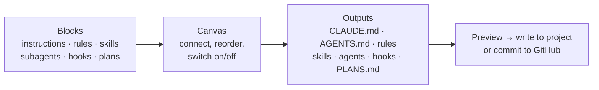

<div align="center">

# Encela

**A desktop companion for AI coding tools: build your Claude Code and Codex setup visually, manage git work, and keep notes per branch, right next to your terminal.**

**English** · [한국어](READMEkr.md) · [中文](READMEzh.md)

[](https://github.com/oceanstarlight/ai-management-pg-fo-desktop/releases/latest)

[](LICENSE)

</div>

> [!NOTE]
> Early development. Windows comes first; Linux and macOS are planned.

<!-- Screenshot: main window (document composer) — e.g. docs/images/composer.png -->

## Why

AI coding tools are configured through a pile of files: `CLAUDE.md`, `AGENTS.md`, rules, skills, subagents, hooks, MCP servers, settings in three different scopes. It is hard to see which ones are actually in effect, and writing them by hand is slow.

Encela puts all of that in one window:

- **Get suggestions** while you write a prompt: the skills, subagents, MCP servers and automations that fit it, in the app and in the Claude Code terminal.
- **See** what your AI tool reads in a project, and from where.
- **Build** instruction files by snapping blocks together instead of writing them from scratch.
- **Work** with git and GitHub without leaving the app, and keep a to-do list for every branch.
- **Dock** a slim sidebar next to your terminal or editor so it is always one glance away.

## Features at a glance

| Screen | What you can do |
|---|---|
| ✨ **Suggestions** (home) | Write a prompt and get matching skills, subagents, commands, MCP servers and automations, used or installed in one click; a live feed of what was suggested for each prompt you sent in Claude Code |
| 🧩 **Document composer** | Drag blocks onto a canvas and write `CLAUDE.md` / `AGENTS.md`, rules, skills, subagents, hooks and `PLANS.md` |
| 🗺️ **Settings map** | See every instruction, rule, skill, subagent, command, MCP server and setting your tool loads, with its scope and status |
| 📄 **Project docs** | Open a folder and edit its AI config files in the app; get told when they change on disk |
| 📚 **Library** | Keep your favorite skills and subagents in one place and switch them on or off per project; install popular open-source extensions from GitHub (plugins, MCP servers) in one click |
| ⏰ **Automations** | Run your `claude` on a schedule (e.g. every morning: collect news with a Haiku subagent and mail it to you); build one in the composer or ask Claude Code to |
| 🔌 **MCP servers** | List, add, edit, remove and health-check MCP servers; paste a JSON snippet or `claude mcp add` command to import |
| 🌿 **Work** | Branches, worktrees, diffs, commit / push / pull, pull requests, CI status, merge-conflict helper |
| 📝 **Notes** | Notes and to-dos for each repository and branch, synced across your devices |
| 📌 **Sidebar** | A narrow panel that docks next to the window you are using and follows it |

## Supported tools

Each project uses one tool. The app detects it from the files in the project (you can override it), and every screen follows that choice.

| | Claude Code | Codex |
|---|:---:|:---:|
| Settings map, library, project docs | ✅ | ✅ |
| Document composer | ✅ | ✅ (instructions go to `AGENTS.md`; Codex has no rules folder) |
| MCP servers | ✅ (with connection check) | ✅ (no connection check) |
| Worktrees, AI commit message draft | ✅ | ✅ |
| Branch-notes mod inside the tool | ✅ | — |

## Install

1. Download the latest `*-setup.exe` from **[Releases](https://github.com/oceanstarlight/ai-management-pg-fo-desktop/releases/latest)**.
2. Run it. The installer is not code-signed yet, so Windows SmartScreen may warn you: choose **More info → Run anyway**.
3. The app checks for updates at launch and every 6 hours and offers **Update and restart**.

**You also need**

- [Claude Code](https://docs.claude.com/en/docs/claude-code) and/or [Codex](https://github.com/openai/codex) installed, if you want the app to work with them. The app runs the `claude` / `codex` command you already have; it never asks for your login.
- [Git](https://git-scm.com/) for the Work screen.

## Getting started

1. **Pick a project.** Open the **Settings map** and choose a project folder. You now see what your tool currently loads for that project, by scope.
2. **Open the Document composer**, drag a few blocks onto the canvas, connect them to an output such as `CLAUDE.md`, and check the preview on the right.
3. **Write to project.** You get a preview of every file change before anything is written.
4. **Switch to sidebar** when you start coding. Press <kbd>Ctrl</kbd>+<kbd>Alt</kbd>+<kbd>Space</kbd> to show or hide it, or use the tray icon to get the main window back.

## A closer look

### ✨ Suggestions

The home screen is a prompt box. As you type, it finds what fits the task: skills, subagents and commands Claude Code already has, items from your library, recommended MCP servers, extensions, and your automations (or "make this an automation" for anything recurring). Keyword matches show at once, then Haiku picks through your own `claude` once you stop typing. Each suggestion is one click: put it in the prompt, add it to the project, install it, add the server, or open a new automation. With the Encela link mod installed, the same suggestions show above the Claude Code prompt, and every prompt you send there shows up in the feed with what was suggested and what you picked. The other screens are under **Tools**.

**Working with Claude Code (with the mod installed):**

1. Start Claude Code (terminal, cmd, or the Code tab of the desktop app), then the app. It finds Claude Code and docks as a sidebar next to it, on the session's project.
2. As you type a prompt, the sidebar shows it live with suggestions. Press **Allow** on one, or turn on **Apply automatically** to use them all when the prompt is sent (library items added, extensions installed, MCP servers added).
3. **Refine prompt** has Haiku rewrite your prompt into a clearer one with the picked items and the project's decisions; **Original** puts your text back.
4. When Claude settles something in its answers (platform, language, framework, database…), it is saved under **Decisions** for the project. You can edit or add them; they go into every prompt as context, bring their own suggestions, and are written to `CLAUDE.md` (a `Project decisions` section) once you confirm.
5. The **Docs** tab of the sidebar edits `CLAUDE.md`, rules, skills, subagents and commands directly. For a GitHub repository without a local clone, commit to a new branch and merge it into the default branch.

Only Claude Code can be detected; the regular chat of the Claude desktop app cannot.

**Connect Claude** (shown on first launch) walks through both setups as checklists. **Claude Code in the cloud (claude.ai/code):** sign in to the app account, turn on the cloud connection, and paste the setup script it gives you into the cloud environment's Setup script (a repository hook with an `ENCELA_RELAY` variable is there as an advanced option). Prompts and answers then reach the app through your account (Firebase; deleted once received). A cloud prompt is seen after it is sent, so what you allow and the decisions are added to the next prompt.

### 🧩 Document composer

<!-- Screenshot: composer canvas with the "Expected effect" panel — e.g. docs/images/composer-ratings.png -->

Build AI instruction files like a node graph.



- **About 100 ready-made blocks**: the app's own, plus license-checked blocks from popular open-source collections (obra/superpowers, mattpocock/skills, anthropics/skills, wshobson/agents, VoltAgent subagents, awesome-cursorrules and more). Source, commit and license are kept with every block; see [`THIRD_PARTY_NOTICES.md`](THIRD_PARTY_NOTICES.md).
- **Expected effect**: each block shows whether it tends to raise or lower **tokens**, **performance** and **quality** (−2 to +2). The canvas adds up the blocks you placed and shows performance, quality and token use as bars.
- **Click a block** to read what it makes the AI do and see its full text. Double-click a block or output to preview the real file.
- **Subagents**: pick the model (Auto, Fable, Opus, Sonnet, Haiku). **Hooks**: set the event and command, merged into your settings after you confirm.
- **Plans**: write a `PLANS.md` with goals, sub-goals and steps (write text, hand off to a subagent, use a skill, ask the user), each marked done / in progress / not yet.
- **Safe writes**: the app only manages its own marked section of `CLAUDE.md` and never silently overwrites a file it did not write.
- **Write without cloning**: send the result straight to a GitHub repository as a commit on a branch or a new pull request.
- Undo / redo, team vs personal outputs (`CLAUDE.md` vs `CLAUDE.local.md`), and "Get latest" to refresh third-party blocks from their source.

### 🗺️ Settings map

Shows everything the tool reads in the selected project: instructions, rules, skills, subagents, commands, MCP servers and settings, grouped by **scope** (personal / project / local) with a **status** (in use, conditional, turned off, shadowed, broken JSON…).

### 📄 Project docs · 📚 Library

- **Project docs** finds `CLAUDE.md` (including in subfolders), `AGENTS.md`, rules, skills, agents, commands and settings files in a folder and lets you edit them in the app.
- **Library** keeps the skills and subagents you reuse. Add one to a project or remove it again with one click.
- **GitHub extensions**: license-checked open-source Claude Code extensions (REA, superpowers, compound-engineering, agent-skills, wshobson/agents, VoltAgent subagents) installed with your own `claude` command.

### ⏰ Automations

- Pick a time (daily, on weekdays) or an interval, a model, the tools it may use, and an email address for the result.
- In the document composer, connect instruction, rule, skill and subagent blocks to an **Automation** output: they become the run's instructions and subagents (e.g. a scraper subagent on Haiku).
- Runs use your own `claude -p` while the app or its tray icon is running; a run missed while the app was closed runs once within a day. Results, cost and errors are kept per run, with a desktop notification.
- Results are mailed through an email MCP server connected to Claude Code (e.g. Gmail). Claude Code can also list, create and run automations through the app's MCP server.

### 🔌 MCP servers

One screen for project (`.mcp.json`), local and personal servers: check if they connect, add / edit / remove them, toggle project servers, or install a recommended server. Secrets are masked, and the app suggests `${VARIABLE}` references instead of pasting keys into files. Personal Claude Code servers are handled through your own `claude mcp` command.

### 🌿 Work (git · GitHub)

<!-- Screenshot: Work screen with the flow card — e.g. docs/images/work.png -->

- A **flow card** shows where the branch is: commit → push → pull request → CI, with a button for the next step.
- Changes with per-file staging, history with diffs, branches and worktrees.
- **Commit message drafts** written by your own `claude` or `codex` CLI.
- **Sign in to GitHub** to see pull requests, CI and issues, create pull requests, and get desktop notifications when CI finishes or a PR is merged or closed.
- **Pick from your GitHub repositories**: open the local clone if you have one; otherwise browse branches, commits and PRs, edit files and commit directly on GitHub, or clone.
- A **conflict helper** walks through each conflicting block (current / incoming / both).

### 📝 Notes & sync

- Notes and to-dos per repository and branch. When you switch branches in the terminal, the notes follow.
- Optional sync across devices (notes, composer documents, library) with an app account: email, Google or GitHub. Sync is currently open to approved accounts only. If two devices edit the same thing, the newer one wins and the other is kept as a copy.

### 🔗 Inside Claude Code: Encela link mod

Install the **Encela link mod** from Settings, or from the card on the Suggestions screen (Claude Code 2.1.287 or later; in Claude Code it is the `branch-notes` plugin). It is what lets the app see your Claude Code prompts. Claude Code then shows this branch's to-dos, PR and CI in one line above the prompt, adds `/todo`, `/memo` and `/notes`, and lets Claude read your notes while it works. As you type a prompt, it suggests matching skills, subagents and commands you have, items from your library (one press adds them to the project), extensions to install, MCP servers and automations. By default Haiku picks them through your own Claude Code once you stop typing; Settings can switch to keyword matching or turn it off. Recommended community mods (token-weather, blast-radius, replay-theater, claude-hud) can be installed from Settings too.

### 📌 Sidebar

Docks next to the window you are using (Windows Terminal, VS Code, Claude desktop, Codex) and follows it. Settings: magnet on/off, always on top, show/hide shortcut, theme, language (English / Korean), text size.

## Privacy & security

- The app **never reads, copies or stores your Claude login** (`~/.claude/.credentials.json` or tokens). AI features run the `claude` / `codex` command you installed, unchanged.
- GitHub and account tokens are kept in the OS credential store (Windows Credential Manager). Git gets the GitHub token only as an environment variable for a single command.
- Settings files are written read-merge-write: keys the app does not know are kept.
- Nothing is synced unless you sign in and turn sync on.

## For developers

<details>
<summary><b>Build from source</b></summary>

**Requirements**

- Node.js 22+ and pnpm 10 (`corepack enable`)
- Rust 1.90+ (`rustup`)
- Windows: [Microsoft C++ Build Tools](https://visualstudio.microsoft.com/visual-cpp-build-tools/) ("Desktop development with C++") and WebView2 (included in Windows 11)
- Linux: `libwebkit2gtk-4.1-dev libxdo-dev libayatana-appindicator3-dev librsvg2-dev`

See also [Tauri prerequisites](https://v2.tauri.app/start/prerequisites/).

```bash
pnpm install
pnpm tauri dev      # run the app in development mode
pnpm lint           # Biome lint + format check
pnpm build          # type check + frontend build
pnpm tauri build    # build the installer
```

Rust checks (in `src-tauri/`):

```bash
cargo fmt --check
cargo clippy --all-targets -- -D warnings
cargo test
```

Claude Code mod checks (in `claude-mod/branch-notes/`):

```bash
claude plugin validate .
claude plugin test .
```

</details>

<details>
<summary><b>Project structure</b></summary>

| Path | What's there |
|---|---|
| `src/` | React 19 + TypeScript frontend (`workspace/` main window, `sidebar/` sidebar, `features/` shared panels) |
| `src-tauri/` | Rust backend (Tauri 2). `tools/` has one adapter per AI tool, `catalog/` the composer blocks |
| `claude-mod/` | The Claude Code mod (talks to the app through files in `<app data>/bridge`) |
| `firebase/` | Security rules for sync |
| `docs/` | Plan, research notes, setup guides, test checklists |

</details>

<details>
<summary><b>Docs</b></summary>

- [`docs/PLAN.md`](docs/PLAN.md): decisions and roadmap
- [`docs/research.md`](docs/research.md): researched facts with sources
- [`docs/sync-setup.md`](docs/sync-setup.md): setting up sync (Firebase)
- [`docs/release-setup.md`](docs/release-setup.md): releases and app updates
- [`docs/testing/`](docs/testing/): manual test checklists

</details>

CI (`.github/workflows/ci.yml`) lints and builds on Linux and builds the Windows installer. Every version merged to `main` becomes a GitHub Release.

## License

[Apache-2.0](LICENSE). Licenses of bundled third-party blocks are listed in [`THIRD_PARTY_NOTICES.md`](THIRD_PARTY_NOTICES.md).

This project is not affiliated with, sponsored or endorsed by Anthropic or OpenAI. Claude is a trademark of Anthropic, PBC. Codex and ChatGPT are trademarks of OpenAI.
