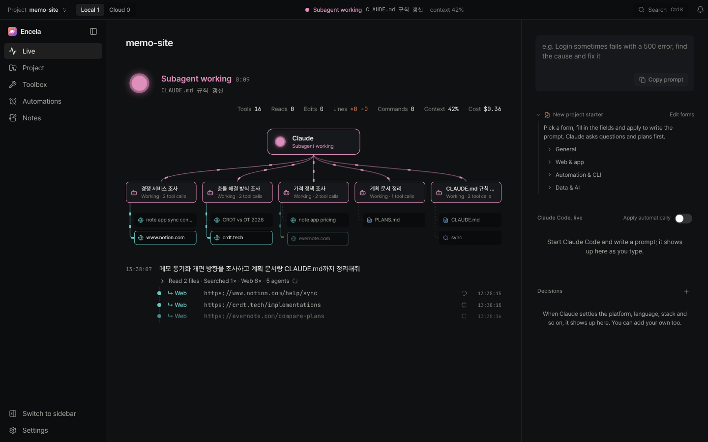
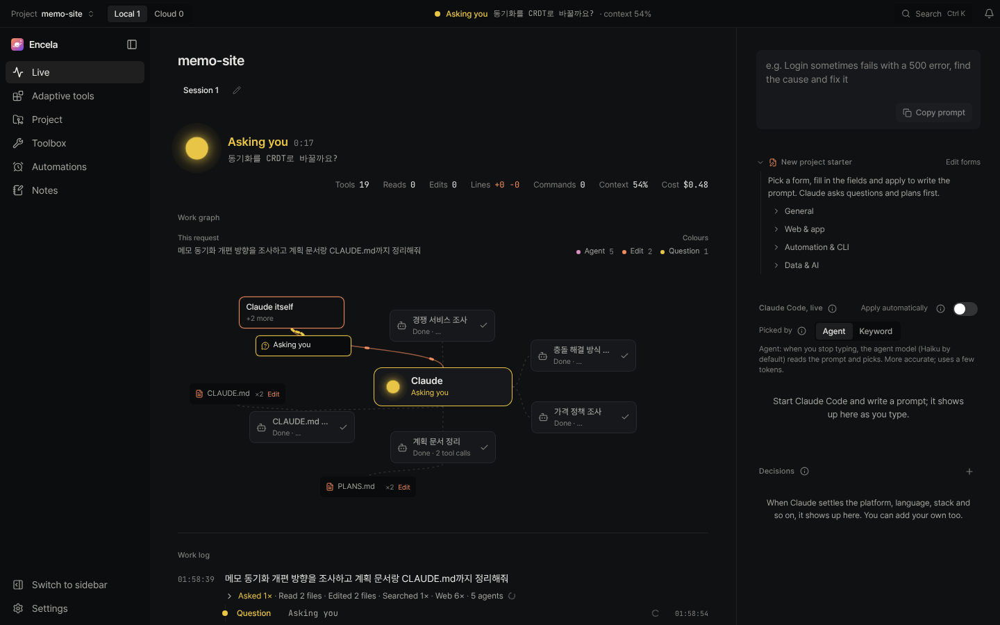
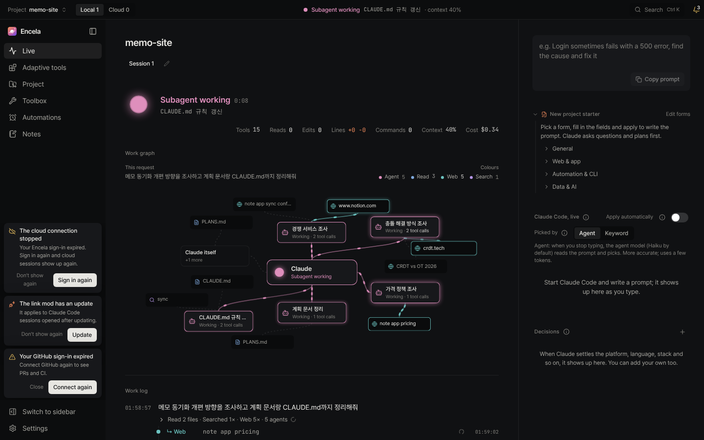
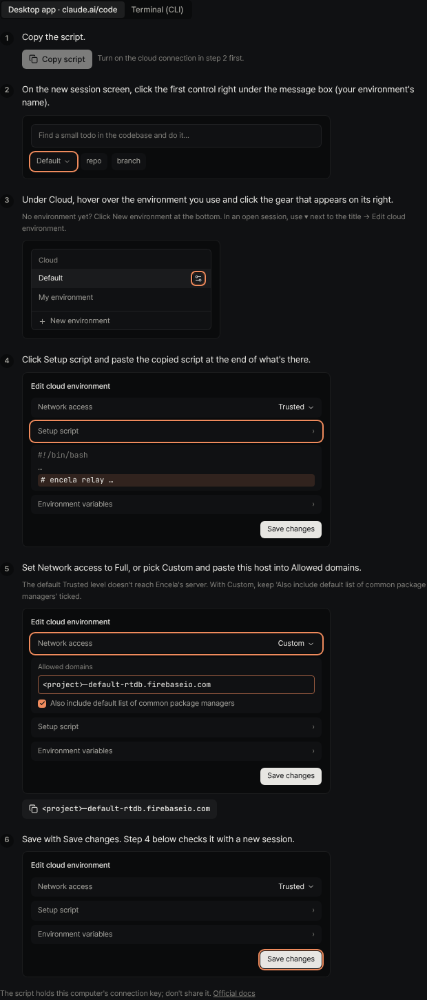

<div align="center">

# Encela

**A desktop companion for Claude Code: watch Claude, its subagents and everything they touch as a live graph, and get the right skills, servers and decisions into your prompts, right next to your terminal.**

**English** · [한국어](READMEkr.md) · [中文](READMEzh.md)

[](https://github.com/oceanstarlight/ai-management-pg-fo-desktop/releases/latest)

[](LICENSE)



</div>

> [!NOTE]
> Early development. Windows comes first; Linux and macOS are planned.

## Why

When Claude Code works on a task, it reads files, edits them, runs commands and starts subagents, and in a terminal that scrolls by fast. Its setup (`CLAUDE.md`, rules, skills, subagents, MCP servers) is spread over many files.

Encela puts both in one window:

- **Watch** what Claude is doing right now: which subagents it started, which files, web pages and tools each one is on, how far the prompt has gone.
- **Get suggestions** while you write a prompt: the skills, subagents, MCP servers and automations that fit it, and a form to start a new project from.
- **Keep** what you and Claude settled (platform, language, framework…) and feed it back into every prompt.
- **Dock** a slim sidebar next to your terminal or editor so it is always one glance away.

## Features at a glance

| Screen | What you can do |
|---|---|
| 📡 **Live** (home) | What Claude Code is doing, as it happens: a status mark and this prompt's numbers (tools, reads, edits, lines, commands, context, cost), a **work graph** of Claude, its subagents and what each one touches, and a timeline that sums up every prompt. Beside it: the prompt box with suggestions, the new-project starter forms, the project's decisions and the branch's notes |
| 📁 **Project** | The project's `CLAUDE.md`, rules, skills, agents and settings files to edit in place; what applies to the project and from where; its decisions; the starter forms |
| 🧰 **Toolbox** | Your library of skills and subagents, MCP servers, open-source extensions, and a catalog of about 100 ready-made blocks to copy |
| ⏰ **Automations** | Run your `claude` on a schedule (e.g. every morning: collect news with a Haiku subagent and mail it to you) |
| 📝 **Notes** | Notes and to-dos for each repository and branch, synced across your devices |
| 📌 **Sidebar** | The live view, suggestions and notes in a narrow panel that docks next to the window you are using |
| 🔔 **Title bar & notices** | The open project, local or cloud sessions, what Claude is doing, <kbd>Ctrl</kbd>+<kbd>K</kbd> search, and notices that stay until you deal with them |

## Supported tools

Live view, suggestions and decisions work with **Claude Code** (terminal, cmd, the Code tab of the Claude desktop app, and claude.ai/code in the cloud). Project documents, the library and MCP servers also work with **Codex** projects.

## Install

1. Download the latest `*-setup.exe` from **[Releases](https://github.com/oceanstarlight/ai-management-pg-fo-desktop/releases/latest)**.
2. Run it. The installer is not code-signed yet, so Windows SmartScreen may warn you: choose **More info → Run anyway**.
3. The app checks for updates at launch and every 6 hours and offers **Update and restart**.

**You also need** [Claude Code](https://docs.claude.com/en/docs/claude-code) 2.1.287 or later. The app runs the `claude` command you already have; it never asks for your login.

## Getting started

1. **Connect Claude**: until something is connected, a notice in the menu says so and takes you there. Install the Encela link mod with one click; for claude.ai/code, follow the step-by-step cloud guide.
2. **Pick a project** in the title bar, and choose **Local** or **Cloud** next to it.
3. **Start Claude Code** in that folder. The app docks next to it as a sidebar and starts drawing what it does. <kbd>Ctrl</kbd>+<kbd>Alt</kbd>+<kbd>Space</kbd> shows or hides it; the tray icon brings the main window back.

## A closer look

### 📡 Live

- **Status**: idle, thinking, reading, searching, editing, running, a subagent at work, asking you… with the file or command it is on and how long the prompt has run.
- **This prompt's numbers**: tool calls, reads, edits, lines added and removed, commands, failures, how full the context window is, and the session's cost so far.
- **Work graph**: Claude sits in the middle; the subagents it starts ring around it, and further out, in the same direction, the files, web searches and pages, searches, MCP tools and questions each one works on. A line with small blocks moving along it is working right now; finished work turns to a dashed line and fades after a few seconds, so the graph keeps showing what is happening. Claude stays until the session ends (or `/clear` starts a new one).
- **Timeline**: like Claude Code's own app: each prompt, one line summing up its tool calls ("Read 2 files · Web 6× · 5 agents", open it for every call), what runs now, and Claude's answer. When Claude asks you something it shows in yellow as **Question · Asking you**.
- **Local or cloud**: pick in the title bar. Local follows the open project folder (several sessions in one folder get tabs, and a note points to a folder where Claude runs if the open one is quiet); Cloud lists cloud sessions, the newest first. Nothing of this is stored or synced; it lives only while the app runs.



### 🔔 Title bar, search and notices

- The main window has its own title bar: the project, **Local / Cloud**, a one-line status of what Claude is doing (and how many sessions run), search, notices and the window buttons.
- <kbd>Ctrl</kbd>+<kbd>K</kbd> finds pages, projects and actions (connect Claude, switch to the sidebar, check for updates…).
- **Notices** stack above the account button, newer on top of older, and under the bell: Claude not connected yet (stays until it is), the cloud connection needing a new sign-in, an expired GitHub sign-in (with the code to sign in again right in the notice), mod and app updates, sync conflicts. Most have **Don't show again**.



### ✨ Suggestions and decisions

As you type (in the app or above the Claude Code prompt), Encela finds what fits the task: skills, subagents and commands Claude Code has, items from your library, MCP servers, extensions, and your automations. Keyword matches show at once, then Haiku picks through your own `claude`. **Refine prompt** rewrites your prompt into a clearer one; **Original** puts your text back. When Claude settles something in its answers, it is saved under **Decisions** and goes into every prompt; it is written to `CLAUDE.md` once you confirm. The **new project starter** forms (general, web & app, automation & CLI, data & AI) sit as a tree beside Live, open by default in a brand-new project; the fields you fill in become the first prompt, and the forms can be edited under Project.

### ☁️ Claude Code in the cloud

Sign in to the app account, turn on the cloud connection, and put the setup script into your cloud environment. Settings walks you through it with a sketch of each screen, for the desktop app or claude.ai/code (environment menu → gear → **Setup script** → **Network access** set to **Full**, or **Custom** with the app's database host under **Allowed domains** → **Save changes**) and for the terminal (`/web-setup`, edit the environment on the web, pick it with `/remote-env`, start with `claude --cloud`).

Prompts, answers and tool calls (tool, file path, the first 300 characters of a command, lines changed; never file contents) reach the app through the Firebase Realtime Database over one streaming connection, and are deleted once received.

<details>
<summary>The step-by-step guide in Settings</summary>



</details>

### 📁 Project · 🧰 Toolbox

- **Documents** finds `CLAUDE.md` (including in subfolders), rules, skills, agents, commands and settings files and lets you edit them in the app. **What applies** shows everything the tool reads, by scope and status, and switches library items on or off per project.
- **Library** keeps the skills and subagents you reuse. **MCP servers**: list, add, edit, remove and health-check them. **Extensions**: license-checked open-source Claude Code extensions installed with your own `claude`. **Catalog**: about 100 ready-made blocks (the app's own plus license-checked ones from open-source collections; see [`THIRD_PARTY_NOTICES.md`](THIRD_PARTY_NOTICES.md)) to read and copy.
- The branch, its local changes and its pull request and CI are shown on the Live screen (sign in to GitHub for PRs and CI); git itself is left to your terminal and Claude Code.

### ⏰ Automations

Pick a time or an interval, a model, the tools it may use, and an email address for the result. Runs use your own `claude -p` while the app or its tray icon is running. Claude Code can also list, create and run automations through the app's MCP server.

### 📝 Notes & sync

Notes and to-dos per repository and branch; they follow the branch you switch to. Inside Claude Code the link mod shows them above the prompt and adds `/todo`, `/memo` and `/notes`. Optional sync across devices with an app account (email, Google or GitHub).

## Privacy & security

- The app **never reads, copies or stores your Claude login** (`~/.claude/.credentials.json` or tokens). AI features run the `claude` / `codex` command you installed, unchanged.
- GitHub and account tokens are kept in the OS credential store (Windows Credential Manager). Git gets the GitHub token only as an environment variable for a single command.
- Settings files are written read-merge-write: keys the app does not know are kept.
- Nothing is synced unless you sign in and turn sync on.

## For developers

<details>
<summary><b>Build from source</b></summary>

**Requirements**

- Node.js 22+ and pnpm 10 (`corepack enable`)
- Rust 1.90+ (`rustup`)
- Windows: [Microsoft C++ Build Tools](https://visualstudio.microsoft.com/visual-cpp-build-tools/) ("Desktop development with C++") and WebView2 (included in Windows 11)
- Linux: `libwebkit2gtk-4.1-dev libxdo-dev libayatana-appindicator3-dev librsvg2-dev`

See also [Tauri prerequisites](https://v2.tauri.app/start/prerequisites/).

```bash
pnpm install
pnpm tauri dev      # run the app in development mode
pnpm lint           # Biome lint + format check
pnpm build          # type check + frontend build
pnpm tauri build    # build the installer
```

Rust checks (in `src-tauri/`):

```bash
cargo fmt --check
cargo clippy --all-targets -- -D warnings
cargo test
```

Claude Code mod checks (in `claude-mod/branch-notes/`):

```bash
claude plugin validate .
claude plugin test .
```

</details>

<details>
<summary><b>Project structure</b></summary>

| Path | What's there |
|---|---|
| `src/` | React 19 + TypeScript frontend (`workspace/` main window and its title bar, `sidebar/` sidebar, `features/` shared panels; `features/live/` the work graph and timeline) |
| `src-tauri/` | Rust backend (Tauri 2). `tools/` has one adapter per AI tool, `catalog/` the block catalog, `activity.rs` the live session view |
| `claude-mod/` | The Claude Code mod (talks to the app through files in `<app data>/bridge`) |
| `firebase/` | Security rules for sync |
| `docs/` | Plan, research notes, setup guides, test checklists |

</details>

<details>
<summary><b>Docs</b></summary>

- [`docs/PLAN.md`](docs/PLAN.md): decisions and roadmap
- [`docs/research.md`](docs/research.md): researched facts with sources
- [`docs/sync-setup.md`](docs/sync-setup.md): setting up sync (Firebase)
- [`docs/release-setup.md`](docs/release-setup.md): releases and app updates
- [`docs/testing/`](docs/testing/): manual test checklists
- [`docs/images/`](docs/images/): README screenshots (from the browser preview, `pnpm dev`, which plays a made-up session)

</details>

CI (`.github/workflows/ci.yml`) lints and builds on Linux and builds the Windows installer. Every version merged to `main` becomes a GitHub Release.

## License

[Apache-2.0](LICENSE). Licenses of bundled third-party blocks are listed in [`THIRD_PARTY_NOTICES.md`](THIRD_PARTY_NOTICES.md).

This project is not affiliated with, sponsored or endorsed by Anthropic or OpenAI. Claude is a trademark of Anthropic, PBC. Codex and ChatGPT are trademarks of OpenAI.
