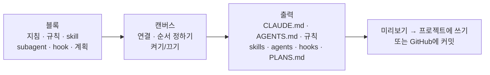

<div align="center">

# Encela (엔셀라)

**AI 코딩 도구 옆에 붙는 데스크탑 앱. Claude Code·Codex 설정을 블록으로 만들고, git 작업을 관리하고, 브랜치마다 메모를 남겨요. 모두 터미널 바로 옆에서요.**

[English](README.md) · **한국어** · [中文](READMEzh.md)

[](https://github.com/oceanstarlight/ai-management-pg-fo-desktop/releases/latest)

[](LICENSE)

</div>

> [!NOTE]
> 개발 초기 단계예요. Windows를 먼저 지원하고, Linux·macOS는 나중에 지원할 예정이에요.

<!-- 스크린샷: 메인 창 (문서 작성기) — 예: docs/images/composer.png -->

## 왜 만들었나요

AI 코딩 도구는 여러 파일로 설정해요. `CLAUDE.md`, `AGENTS.md`, 규칙, skill, subagent, hook, MCP 서버, 그리고 범위가 셋이나 되는 설정 파일까지요. 지금 어떤 게 실제로 적용되고 있는지 알기 어렵고, 손으로 쓰기도 번거로워요.

Encela는 이걸 한 화면에 모아요.

- **추천받기**: 프롬프트를 쓰는 동안 맞는 skill·subagent·MCP 서버·자동화를 앱과 Claude Code 터미널에서 바로 추천받아요.
- **보기**: 프로젝트에서 AI 도구가 무엇을, 어디서 읽는지 한눈에 봐요.
- **만들기**: 지침 파일을 처음부터 쓰지 않고 블록을 이어 붙여 만들어요.
- **작업하기**: 앱 안에서 git·GitHub 작업을 하고, 브랜치마다 할 일 목록을 둬요.
- **붙이기**: 얇은 사이드바가 터미널이나 에디터 옆에 붙어서 늘 곁에 있어요.

## 기능 한눈에 보기

| 화면 | 할 수 있는 것 |
|---|---|
| ✨ **추천** (홈) | 프롬프트를 쓰면 맞는 skill·subagent·명령·MCP 서버·자동화를 찾아 주고, 한 번에 쓰거나 설치해요. Claude Code에서 보낸 프롬프트마다 무엇을 추천했는지 실시간으로 쌓여요 |
| 🧩 **문서 작성기** | 블록을 캔버스에 끌어 놓아 `CLAUDE.md` / `AGENTS.md`, 규칙, skill, subagent, hook, `PLANS.md`를 만들어요 |
| 🗺️ **설정 지도** | 도구가 읽는 지침·규칙·skill·subagent·명령·MCP 서버·설정을 범위·상태와 함께 보여줘요 |
| 📄 **프로젝트 문서** | 폴더를 열면 AI 설정 파일을 앱 안에서 고칠 수 있고, 밖에서 바뀌면 알려줘요 |
| 📚 **라이브러리** | 자주 쓰는 skill·subagent를 모아 두고 프로젝트마다 켜고 꺼요. GitHub의 인기 오픈소스 확장(플러그인, MCP 서버)도 한 번에 설치해요 |
| ⏰ **자동화** | 정해진 시간에 내 `claude`가 일을 해요(예: 매일 아침 Haiku 서브에이전트로 뉴스를 모아 메일로 받기). 문서 작성기에서 만들거나 Claude Code에 부탁해요 |
| 🔌 **MCP 서버** | MCP 서버를 보고·추가·수정·삭제하고 연결을 확인해요. JSON이나 `claude mcp add` 명령을 붙여넣어 가져올 수도 있어요 |
| 🌿 **작업** | 브랜치, worktree, diff, 커밋·push·pull, PR, CI 상태, 충돌 해결 도우미 |
| 📝 **메모** | 저장소·브랜치마다 메모와 할 일. 여러 기기에서 동기화돼요 |
| 📌 **사이드바** | 지금 쓰는 창 옆에 붙어서 따라다니는 좁은 패널 |

## 지원하는 도구

프로젝트마다 도구 하나를 써요. 앱이 프로젝트 파일을 보고 도구를 알아서 고르고(직접 바꿀 수도 있어요), 모든 화면이 그 도구 기준으로 동작해요.

| | Claude Code | Codex |
|---|:---:|:---:|
| 설정 지도, 라이브러리, 프로젝트 문서 | ✅ | ✅ |
| 문서 작성기 | ✅ | ✅ (지침은 `AGENTS.md`로. Codex에는 규칙 폴더가 없어요) |
| MCP 서버 | ✅ (연결 확인 포함) | ✅ (연결 확인 없음) |
| worktree, AI 커밋 메시지 초안 | ✅ | ✅ |
| 도구 안에서 동작하는 엔셀라 연결 mod | ✅ | — |

## 설치

1. **[Releases](https://github.com/oceanstarlight/ai-management-pg-fo-desktop/releases/latest)**에서 최신 `*-setup.exe`를 받아요.
2. 실행해요. 아직 코드 서명이 없어서 Windows SmartScreen 경고가 뜰 수 있어요. **추가 정보 → 실행**을 누르면 돼요.
3. 앱은 켤 때와 6시간마다 업데이트를 확인하고, **업데이트 후 다시 시작**을 띄워줘요.

**같이 필요한 것**

- AI 기능을 쓰려면 [Claude Code](https://docs.claude.com/en/docs/claude-code)나 [Codex](https://github.com/openai/codex)가 설치돼 있어야 해요. 앱은 이미 설치된 `claude` / `codex` 명령을 그대로 실행하고, 로그인 정보를 묻지 않아요.
- 작업 화면을 쓰려면 [Git](https://git-scm.com/)이 필요해요.

## 시작하기

1. **프로젝트 고르기**: **설정 지도**를 열고 프로젝트 폴더를 골라요. 도구가 지금 그 프로젝트에서 읽는 설정이 범위별로 보여요.
2. **문서 작성기 열기**: 블록 몇 개를 캔버스에 끌어 놓고 `CLAUDE.md` 같은 출력에 연결한 뒤, 오른쪽 미리보기를 확인해요.
3. **프로젝트에 쓰기**: 파일에 쓰기 전에 바뀌는 내용을 전부 미리 보여줘요.
4. **사이드바로 전환**: 코딩을 시작할 때 눌러요. <kbd>Ctrl</kbd>+<kbd>Alt</kbd>+<kbd>Space</kbd>로 보이고 숨기고, 트레이 아이콘으로 메인 창을 다시 열어요.

## 자세히 보기

### ✨ 추천

홈 화면은 프롬프트 입력창이에요. 쓰는 동안 할 일에 맞는 것을 찾아 줘요: Claude Code에 이미 있는 skill·subagent·명령, 라이브러리 항목, 추천 MCP 서버, 확장, 내 자동화(반복할 일이면 "자동화로 만들기"). 키워드로 찾은 건 바로 보이고, 입력을 멈추면 내 `claude`로 Haiku가 골라 줘요. 추천은 한 번 누르면 돼요: 프롬프트에 넣기, 프로젝트에 추가, 설치, 서버 추가, 새 자동화 열기. 엔셀라 연결 mod를 설치하면 Claude Code 입력창 위에도 같은 추천이 뜨고, 거기서 보낸 프롬프트마다 무엇이 추천됐고 무엇을 골랐는지 피드에 쌓여요. 나머지 화면은 **도구** 아래에 있어요.

**Claude Code와 함께 쓰기 (mod 설치 시):**

1. Claude Code(터미널, cmd, 데스크톱 앱의 Code 탭)를 실행하고 앱을 켜요. 앱이 Claude Code를 찾아서 옆에 사이드바로 붙고, 그 세션의 프로젝트를 골라요.
2. 프롬프트를 쓰는 동안 사이드바에 실시간으로 보이고 추천이 떠요. **허용**을 누르거나, **자동 적용**을 켜면 프롬프트를 보낼 때 모두 적용해요(라이브러리 추가, 확장 설치, MCP 추가).
3. **프롬프트 다듬기**는 고른 항목과 프로젝트 결정을 넣어 Haiku가 프롬프트를 더 명확하게 고쳐 줘요. **원문으로**로 되돌려요.
4. Claude가 답변에서 정한 것(플랫폼, 언어, 프레임워크, DB 등)은 프로젝트의 **결정된 내용**에 저장돼요. 직접 고치거나 추가할 수 있고, 매 프롬프트에 맥락으로 들어가고, 그에 맞는 추천이 뜨고, 확인하면 `CLAUDE.md`의 `Project decisions` 섹션에 써요.
5. 사이드바 **문서** 탭에서 `CLAUDE.md`·rule·skill·subagent·명령을 바로 고쳐요. 로컬 클론이 없는 GitHub 저장소는 새 브랜치에 커밋하고 기본 브랜치로 머지할 수 있어요.

감지는 Claude Code만 돼요. Claude 데스크톱 앱의 일반 채팅은 감지할 수 없어요.

### 🧩 문서 작성기

<!-- 스크린샷: 캔버스와 '예상 효과' 패널 — 예: docs/images/composer-ratings.png -->

노드 그래프처럼 AI 지침 파일을 만들어요.



- **바로 쓸 수 있는 블록 약 100개**: 앱이 직접 만든 블록과, 라이선스를 확인한 인기 오픈소스 모음(obra/superpowers, mattpocock/skills, anthropics/skills, wshobson/agents, VoltAgent subagents, awesome-cursorrules 등)의 블록이에요. 블록마다 출처·커밋·라이선스가 함께 기록돼요([`THIRD_PARTY_NOTICES.md`](THIRD_PARTY_NOTICES.md)).
- **예상 효과**: 블록마다 **토큰**·**성능**·**품질**을 올리는지 내리는지 화살표로 보여줘요(−2~+2). 캔버스는 놓인 블록을 더해서 성능·품질·토큰 소모를 막대로 보여줘요.
- **블록을 누르면** AI가 무엇을 하게 되는지 설명과 전체 내용이 보여요. 블록이나 출력을 더블클릭하면 실제 파일을 미리 봐요.
- **subagent**는 모델(자동·Fable·Opus·Sonnet·Haiku)을 고를 수 있어요. **hook**은 이벤트와 명령을 정하면, 확인을 받은 뒤 설정 파일에 합쳐 넣어요.
- **계획**: 주요 목표·보조 목표·단계(지침 글, subagent에게 맡기기, skill 쓰기, 확인 질문)로 `PLANS.md`를 만들고, 각각 완료·진행 중·예정으로 표시해요.
- **안전한 쓰기**: `CLAUDE.md`에서는 앱이 표시해 둔 구역만 관리하고, 앱이 쓰지 않은 파일은 묻지 않고 덮어쓰지 않아요.
- **clone 없이 쓰기**: 결과를 GitHub 저장소에 바로 커밋하거나 새 PR로 보낼 수 있어요.
- 실행 취소·다시 실행, 팀용·나만 출력(`CLAUDE.md` / `CLAUDE.local.md`), 외부 블록을 원본에서 새로 받는 "최신 받아오기"도 있어요.

### 🗺️ 설정 지도

고른 프로젝트에서 도구가 읽는 모든 것(지침, 규칙, skill, subagent, 명령, MCP 서버, 설정)을 **범위**(개인 / 프로젝트 / 로컬)별로, **상태**(사용 중, 조건부, 꺼짐, 가려짐, JSON 오류 등)와 함께 보여줘요.

### 📄 프로젝트 문서 · 📚 라이브러리

- **프로젝트 문서**는 폴더 안의 `CLAUDE.md`(하위 폴더 포함), `AGENTS.md`, 규칙, skill, agent, 명령, 설정 파일을 찾아서 앱 안에서 고치게 해줘요.
- **라이브러리**에는 자주 쓰는 skill·subagent를 모아 둬요. 클릭 한 번으로 프로젝트에 넣거나 빼요.
- **GitHub 확장**: 라이선스를 확인한 오픈소스 Claude Code 확장(REA, superpowers, compound-engineering, agent-skills, wshobson/agents, VoltAgent subagents)을 내 `claude` 명령으로 설치해요.

### ⏰ 자동화

- 시간(매일, 요일 지정)이나 간격, 모델, 허용할 도구, 결과를 받을 메일 주소를 정해요.
- 문서 작성기에서 지침·규칙·skill·서브에이전트 블록을 **자동화** 출력에 연결하면, 실행 때 쓰는 지침과 서브에이전트가 돼요(예: Haiku로 도는 스크래퍼 서브에이전트).
- 앱이나 트레이 아이콘이 켜져 있는 동안 내 `claude -p`로 실행해요. 앱이 꺼져 있어 놓친 실행은 하루 안이면 한 번 실행해요. 실행마다 결과·비용·오류를 남기고 데스크톱 알림을 보내요.
- 결과는 Claude Code에 연결한 메일 MCP 서버(예: Gmail)로 보내요. Claude Code도 앱의 MCP 서버로 자동화를 보고, 만들고, 실행할 수 있어요.

### 🔌 MCP 서버

프로젝트(`.mcp.json`)·로컬·개인 서버를 한 화면에서 다뤄요. 연결되는지 확인하고, 추가·수정·삭제하고, 프로젝트 서버를 켜고 끄고, 추천 서버를 넣을 수 있어요. 비밀값은 가려서 보여주고, 키를 파일에 그대로 넣는 대신 `${변수}` 참조를 쓰도록 안내해요. Claude Code 개인 서버는 사용자의 `claude mcp` 명령으로 다뤄요.

### 🌿 작업 (git · GitHub)

<!-- 스크린샷: 흐름 카드가 있는 작업 화면 — 예: docs/images/work.png -->

- **흐름 카드**가 브랜치가 어디까지 왔는지 보여줘요: 커밋 → 올리기 → PR → CI. 다음 할 일 버튼도 있어요.
- 파일별로 커밋에 담기/빼기, diff가 있는 기록, 브랜치와 worktree.
- 내 `claude`나 `codex` 명령으로 **커밋 메시지 초안**을 만들어요.
- **GitHub에 로그인**하면 PR·CI·이슈를 보고 PR을 만들 수 있고, CI가 끝나거나 PR이 병합·닫히면 데스크탑 알림을 받아요.
- **내 GitHub 저장소에서 고르기**: 로컬에 clone이 있으면 그 폴더를 열고, 없으면 GitHub에서 바로 브랜치·커밋·PR을 보고, 파일을 고쳐 커밋하거나 clone해요.
- **충돌 해결 도우미**가 충돌 블록마다 현재 / 들어오는 / 둘 다 중에서 고르게 도와줘요.

### 📝 메모 · 동기화

- 저장소·브랜치마다 메모와 할 일을 남겨요. 터미널에서 브랜치를 바꾸면 메모도 따라 바뀌어요.
- 앱 계정(이메일·Google·GitHub)으로 여러 기기에서 메모·작성기 문서·라이브러리를 동기화할 수 있어요(선택). 두 기기에서 같은 걸 고치면 나중 것을 남기고 다른 것은 사본으로 보관해요. 지금은 승인된 계정만 동기화를 쓸 수 있어요.

### 🔗 Claude Code 안에서: 엔셀라 연결 mod

설정이나 추천 화면의 안내 카드에서 **엔셀라 연결 mod**를 설치하면(Claude Code 2.1.287 이상, Claude Code 안에서는 `branch-notes` 플러그인) 앱이 Claude Code 프롬프트를 감지할 수 있고, Claude Code 입력창 위에 이 브랜치의 할 일·PR·CI가 한 줄로 보이고, `/todo` · `/memo` · `/notes`를 쓸 수 있고, Claude가 내 메모를 알고 작업해요. 프롬프트를 쓰면 맞는 skill·서브에이전트·명령(이미 있는 것), 라이브러리 항목(누르면 프로젝트에 추가), 설치할 확장, MCP 서버, 자동화를 입력창 위에 추천해요. 기본은 입력을 멈추면 내 Claude Code로 Haiku가 골라 주고, 설정에서 키워드 방식으로 바꾸거나 끌 수 있어요. 추천 커뮤니티 mods(token-weather, blast-radius, replay-theater, claude-hud)도 설정에서 설치할 수 있어요.

### 📌 사이드바

지금 쓰는 창(Windows Terminal, VS Code, Claude 데스크탑, Codex) 옆에 붙어서 따라다녀요. 설정: 자석 켜기/끄기, 항상 위, 보이기/숨기기 단축키, 테마, 언어(한국어 / 영어), 글자 크기.

## 개인정보 · 보안

- **Claude 로그인 정보**(`~/.claude/.credentials.json`, 토큰)는 **읽지도, 복사하지도, 저장하지도 않아요.** AI 기능은 사용자가 설치한 `claude` / `codex` 명령을 그대로 실행해요.
- GitHub·계정 토큰은 OS 자격 증명 저장소(Windows 자격 증명 관리자)에 보관해요. git에는 명령 한 번에만 환경 변수로 GitHub 토큰을 넘겨요.
- 설정 파일은 읽기 → 병합 → 쓰기로 고쳐요. 앱이 모르는 키도 그대로 남아요.
- 로그인하고 동기화를 켜기 전에는 아무것도 서버로 보내지 않아요.

## 개발자용

<details>
<summary><b>소스에서 빌드하기</b></summary>

**필요한 것**

- Node.js 22+ 와 pnpm 10 (`corepack enable`)
- Rust 1.90+ (`rustup`)
- Windows: [Microsoft C++ Build Tools](https://visualstudio.microsoft.com/visual-cpp-build-tools/)("C++를 사용한 데스크톱 개발") + WebView2 (Windows 11은 기본 포함)
- Linux: `libwebkit2gtk-4.1-dev libxdo-dev libayatana-appindicator3-dev librsvg2-dev`

[Tauri prerequisites](https://v2.tauri.app/start/prerequisites/)도 참고하세요.

```bash
pnpm install
pnpm tauri dev      # 개발 모드로 앱 실행
pnpm lint           # Biome 린트·포맷 검사
pnpm build          # 타입 검사 + 프론트엔드 빌드
pnpm tauri build    # 설치 파일 빌드
```

Rust 검사 (`src-tauri/`에서):

```bash
cargo fmt --check
cargo clippy --all-targets -- -D warnings
cargo test
```

Claude Code mod 검사 (`claude-mod/branch-notes/`에서):

```bash
claude plugin validate .
claude plugin test .
```

</details>

<details>
<summary><b>폴더 구조</b></summary>

| 경로 | 내용 |
|---|---|
| `src/` | React 19 + TypeScript 프론트엔드 (`workspace/` 메인 창, `sidebar/` 사이드바, `features/` 공용 패널) |
| `src-tauri/` | Rust 백엔드 (Tauri 2). `tools/`에 AI 도구별 어댑터, `catalog/`에 문서 작성기 블록 |
| `claude-mod/` | Claude Code mod (앱과 `<앱 데이터>/bridge` 파일로 주고받아요) |
| `firebase/` | 동기화 보안 규칙 |
| `docs/` | 계획, 조사 자료, 설정 가이드, 테스트 체크리스트 |

</details>

<details>
<summary><b>문서</b></summary>

- [`docs/PLAN.md`](docs/PLAN.md): 결정 사항과 로드맵
- [`docs/research.md`](docs/research.md): 출처가 있는 조사 자료
- [`docs/sync-setup.md`](docs/sync-setup.md): 동기화(Firebase) 설정
- [`docs/release-setup.md`](docs/release-setup.md): 릴리스와 앱 업데이트
- [`docs/testing/`](docs/testing/): 수동 테스트 체크리스트

</details>

CI(`.github/workflows/ci.yml`)가 Linux에서 린트·빌드하고 Windows 설치 파일을 빌드해요. `main`에 병합된 새 버전은 GitHub Release로 올라가요.

## 라이선스

[Apache-2.0](LICENSE). 번들한 서드파티 블록의 라이선스는 [`THIRD_PARTY_NOTICES.md`](THIRD_PARTY_NOTICES.md)에 있어요.

이 프로젝트는 Anthropic이나 OpenAI와 관련이 없으며, 후원이나 보증을 받지 않아요. Claude는 Anthropic, PBC의 상표이고, Codex와 ChatGPT는 OpenAI의 상표예요.
