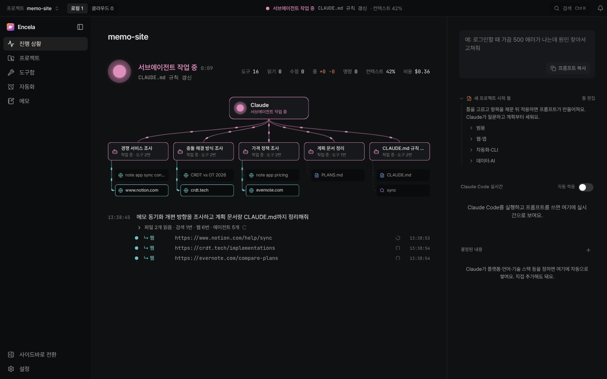
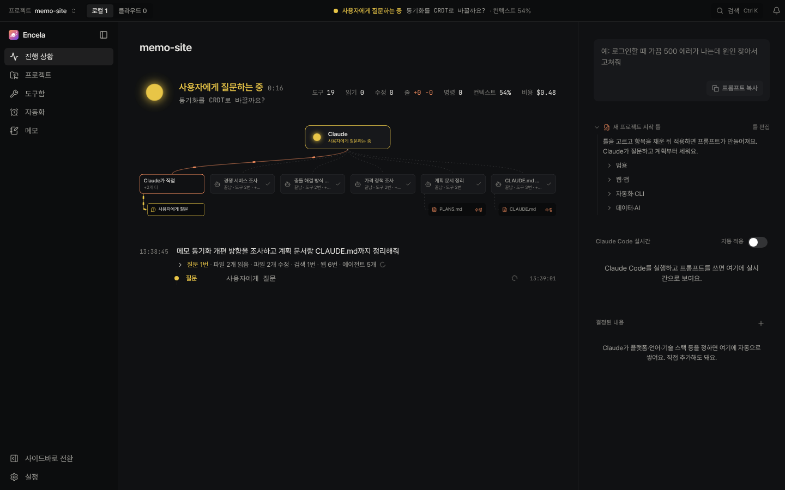
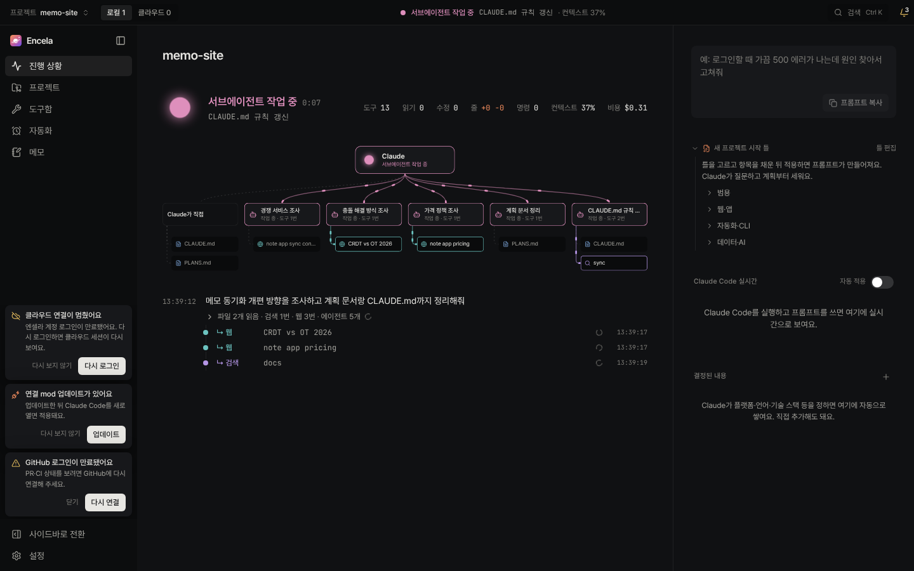
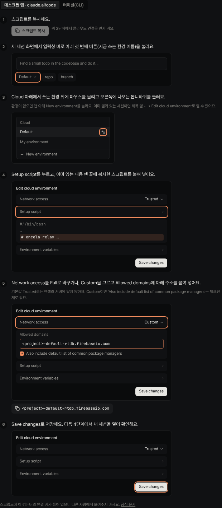

<div align="center">

# Encela (엔셀라)

**Claude Code 옆에 붙는 데스크탑 앱. Claude와 서브에이전트가 무엇을 하고 무엇을 건드리는지 실시간 그래프로 보여주고, 알맞은 skill·서버·결정을 프롬프트에 넣어 줘요. 모두 터미널 바로 옆에서요.**

[English](README.md) · **한국어** · [中文](READMEzh.md)

[](https://github.com/oceanstarlight/ai-management-pg-fo-desktop/releases/latest)

[](LICENSE)



</div>

> [!NOTE]
> 개발 초기 단계예요. Windows를 먼저 지원하고, Linux·macOS는 나중에 지원할 예정이에요.

## 왜 만들었나요

Claude Code는 작업하면서 파일을 읽고, 고치고, 명령을 실행하고, 서브에이전트를 띄워요. 그런데 터미널에서는 이게 빠르게 지나가 버려요. 설정(`CLAUDE.md`, 규칙, skill, subagent, MCP 서버)도 여러 파일에 흩어져 있고요.

엔셀라는 둘을 한 창에 모아요.

- **보기**: Claude가 지금 어떤 서브에이전트를 띄웠는지, 각자 어떤 파일·웹 페이지·도구를 다루는지, 이번 프롬프트가 얼마나 진행됐는지 실시간으로 보여요.
- **추천**: 프롬프트를 쓰는 동안 맞는 skill·subagent·MCP 서버·자동화를 찾아 주고, 새 프로젝트면 시작 틀을 줘요.
- **결정 기록**: Claude와 정한 것(플랫폼·언어·프레임워크…)을 저장해서 매 프롬프트에 다시 넣어요.
- **사이드바**: 터미널이나 편집기 옆에 좁은 사이드바로 붙어서 늘 한눈에 보여요.

## 기능 한눈에 보기

| 화면 | 할 수 있는 것 |
|---|---|
| 📡 **진행 상황** (홈) | Claude Code가 하는 일을 실시간으로: 상태 표시와 이번 프롬프트 수치(도구·읽기·수정·줄 수·명령·컨텍스트·비용), Claude·서브에이전트·작업 대상을 잇는 **작업 그래프**, 프롬프트마다 요약해 주는 진행 기록. 옆에는 프롬프트 입력창과 추천, 새 프로젝트 시작 틀, 프로젝트 결정, 브랜치 메모 |
| 📁 **프로젝트** | `CLAUDE.md`·규칙·skill·agent·설정 파일 편집, 프로젝트에 무엇이 어디서 적용되는지(적용 현황), 결정, 시작 틀 편집 |
| 🧰 **도구함** | 내 skill·subagent 라이브러리, MCP 서버, 오픈소스 확장, 복사해 쓰는 블록 카탈로그(약 100개) |
| ⏰ **자동화** | 정해진 시간에 내 `claude` 실행(예: 매일 아침 Haiku 서브에이전트로 뉴스를 모아 메일로) |
| 📝 **메모** | 저장소·브랜치별 메모와 할 일, 여러 기기 동기화 |
| 📌 **사이드바** | 진행 상황·추천·메모를 좁은 패널로, 지금 쓰는 창 옆에 붙어요 |
| 🔔 **타이틀바 · 알림** | 열린 프로젝트, 로컬/클라우드 세션, Claude가 하는 일 한 줄, <kbd>Ctrl</kbd>+<kbd>K</kbd> 검색, 처리할 때까지 남는 알림 |

## 지원하는 도구

진행 상황·추천·결정은 **Claude Code**(터미널, cmd, Claude 데스크톱 앱의 Code 탭, 클라우드 claude.ai/code)에서 돼요. 프로젝트 문서·라이브러리·MCP 서버는 **Codex** 프로젝트도 돼요.

## 설치

1. **[Releases](https://github.com/oceanstarlight/ai-management-pg-fo-desktop/releases/latest)**에서 최신 `*-setup.exe`를 받아요.
2. 실행해요. 아직 코드 서명이 없어서 Windows SmartScreen이 경고하면 **추가 정보 → 실행**을 눌러요.
3. 앱이 시작할 때와 6시간마다 업데이트를 확인하고 **업데이트 후 다시 시작**을 띄워요.

**같이 필요한 것**: [Claude Code](https://docs.claude.com/en/docs/claude-code) 2.1.287 이상. 앱은 이미 설치된 `claude` 명령을 그대로 실행하고 로그인 정보는 묻지 않아요.

## 시작하기

1. **Claude 연결**: 아무것도 연결되지 않았으면 메뉴에 알림이 계속 떠 있고, 누르면 설정으로 가요. 엔셀라 연결 mod를 한 번에 설치하고, claude.ai/code는 단계별 클라우드 안내를 따라가요.
2. 타이틀바에서 **프로젝트를 고르고**, 옆에서 **로컬 / 클라우드**를 골라요.
3. 그 폴더에서 **Claude Code를 실행해요**. 앱이 옆에 사이드바로 붙어서 하는 일을 그리기 시작해요. <kbd>Ctrl</kbd>+<kbd>Alt</kbd>+<kbd>Space</kbd>로 보이기/숨기기, 트레이 아이콘으로 메인 창을 다시 열어요.

## 자세히 보기

### 📡 진행 상황

- **상태**: 대기, 생각하는 중, 읽는 중, 찾는 중, 고치는 중, 실행하는 중, 서브에이전트 작업 중, 사용자에게 질문하는 중… 지금 다루는 파일이나 명령, 이번 프롬프트 경과 시간.
- **이번 프롬프트 수치**: 도구 호출, 읽기, 수정, 추가·삭제한 줄, 명령, 실패, 컨텍스트 사용률, 세션 비용.
- **작업 그래프**: 맨 위에 Claude, 그 아래 Claude가 띄운 서브에이전트, 각 서브에이전트 아래에 작업 대상(파일, 웹 검색·페이지, 검색, MCP 도구, 질문)이 붙어요. 작은 블록이 대상 쪽으로 흘러가는 선은 지금 작업 중이고, 끝난 작업은 점선이 됐다가 몇 초 뒤 사라져서 지금 일어나는 일이 계속 보여요. Claude는 세션이 끝날 때까지(또는 `/clear`로 새 세션이 될 때까지) 남아요.
- **진행 기록**: Claude Code 앱처럼 프롬프트마다 도구 호출을 한 줄로 요약해요("파일 2개 읽음 · 웹 6번 · 에이전트 5개", 누르면 전부 펼쳐져요). 지금 실행 중인 것과 Claude의 답변도 같이 보여요. Claude가 질문하면 노란색 **질문 · 사용자에게 질문**으로 보여요.
- **로컬 / 클라우드**: 타이틀바에서 골라요. 로컬은 열린 프로젝트 폴더를 따라가고(한 폴더에 세션이 여러 개면 탭이 생기고, 열린 폴더가 조용하면 Claude가 실행 중인 다른 폴더를 알려줘요), 클라우드는 클라우드 세션을 최신순으로 골라요. 이 기록은 저장·동기화하지 않고 앱이 켜져 있는 동안만 있어요.



### 🔔 타이틀바 · 검색 · 알림

- 메인 창은 직접 그린 타이틀바를 써요: 프로젝트, **로컬 / 클라우드**, Claude가 하는 일 한 줄(실행 중인 세션 수 포함), 검색, 알림, 창 버튼.
- <kbd>Ctrl</kbd>+<kbd>K</kbd>로 페이지·프로젝트·할 일(Claude 연결, 사이드바로 전환, 업데이트 확인…)을 찾아요.
- **알림**은 메뉴의 계정 버튼 위에 새것이 위로 쌓이고, 종 아이콘에서도 볼 수 있어요: Claude 미연결(연결될 때까지 남음), 클라우드 연결 재로그인 필요, GitHub 로그인 만료(알림 안에서 바로 코드 받아 다시 연결), mod·앱 업데이트, 동기화 충돌. 대부분 **다시 보지 않기**가 있어요.



### ✨ 추천과 결정

앱이나 Claude Code 입력창 위에서 프롬프트를 쓰면 맞는 것을 찾아요: Claude Code에 있는 skill·subagent·명령, 라이브러리 항목, MCP 서버, 확장, 자동화. 키워드로 바로 찾고, 잠시 멈추면 내 `claude`로 Haiku가 골라요. **다듬기**는 프롬프트를 더 명확하게 고쳐 쓰고, **원문**은 되돌려요. Claude가 답변에서 정한 것은 **결정**에 저장돼 매 프롬프트에 들어가고, 확인하면 `CLAUDE.md`에 써요. **새 프로젝트 시작 틀**(범용·웹/앱·자동화/CLI·데이터/AI)은 진행 상황 오른쪽에 트리로 있고 새 프로젝트에서는 펼쳐진 채로 시작해요. 항목을 채우면 첫 프롬프트가 만들어지고, 틀은 프로젝트 화면에서 고칠 수 있어요.

### ☁️ 클라우드 Claude Code

앱 계정에 로그인하고, 클라우드 연결을 켜고, 설정 스크립트를 클라우드 환경에 넣어요. 설정 화면이 화면마다 그림을 곁들여 단계별로 안내해요. 데스크톱 앱·claude.ai/code는 환경 메뉴 → 톱니바퀴 → **Setup script**에 붙여넣기 → **Network access**를 **Full**로, 또는 **Custom**으로 하고 **Allowed domains**에 앱의 데이터베이스 주소 추가 → **Save changes** 순서예요. 터미널은 `/web-setup` → 웹에서 환경 편집 → `/remote-env`로 선택 → `claude --cloud`로 시작해요.

프롬프트·답변·도구 호출(도구, 파일 경로, 명령 앞 300자, 바뀐 줄 수. 파일 내용은 보내지 않음)이 Firebase Realtime Database를 거쳐 스트리밍 연결 하나로 앱에 오고, 받은 뒤 바로 지워요.

<details>
<summary>설정 화면의 단계별 안내</summary>



</details>

### 📁 프로젝트 · 🧰 도구함

- **문서**는 `CLAUDE.md`(하위 폴더 포함)·규칙·skill·agent·명령·설정 파일을 찾아 앱에서 고치게 해요. **적용 현황**은 도구가 읽는 모든 것을 범위·상태별로 보여주고, 라이브러리 항목을 프로젝트마다 켜고 꺼요.
- **라이브러리**는 다시 쓰는 skill·subagent를 모아요. **MCP 서버**는 목록·추가·편집·삭제·연결 확인. **확장**은 라이선스를 확인한 오픈소스 Claude Code 확장을 내 `claude`로 설치. **카탈로그**는 약 100개의 블록(앱 자체 + 라이선스를 확인한 오픈소스 모음, [`THIRD_PARTY_NOTICES.md`](THIRD_PARTY_NOTICES.md))을 읽고 복사해요.
- 브랜치·로컬 변경·PR·CI는 진행 상황 화면에 보여요(PR·CI는 GitHub 로그인 필요). git 조작은 터미널과 Claude Code에 맡겨요.

### ⏰ 자동화

시간이나 간격, 모델, 쓸 수 있는 도구, 결과를 받을 이메일을 정해요. 앱이나 트레이 아이콘이 켜져 있는 동안 내 `claude -p`로 실행해요. Claude Code도 앱의 MCP 서버로 자동화를 보고 만들고 실행할 수 있어요.

### 📝 메모 · 동기화

저장소·브랜치별 메모와 할 일. 브랜치를 바꾸면 따라가요. Claude Code 안에서는 연결 mod가 입력창 위에 보여주고 `/todo`, `/memo`, `/notes`를 추가해요. 앱 계정(이메일·Google·GitHub)으로 여러 기기에 동기화할 수 있어요.

## 개인정보 · 보안

- **Claude 로그인 정보**(`~/.claude/.credentials.json`, 토큰)는 **읽지도, 복사하지도, 저장하지도 않아요.** AI 기능은 사용자가 설치한 `claude` / `codex` 명령을 그대로 실행해요.
- GitHub·계정 토큰은 OS 자격 증명 저장소(Windows 자격 증명 관리자)에 보관해요. git에는 명령 한 번에만 환경 변수로 GitHub 토큰을 넘겨요.
- 설정 파일은 읽기 → 병합 → 쓰기로 고쳐요. 앱이 모르는 키도 그대로 남아요.
- 로그인하고 동기화를 켜기 전에는 아무것도 서버로 보내지 않아요.

## 개발자용

<details>
<summary><b>소스에서 빌드하기</b></summary>

**필요한 것**

- Node.js 22+ 와 pnpm 10 (`corepack enable`)
- Rust 1.90+ (`rustup`)
- Windows: [Microsoft C++ Build Tools](https://visualstudio.microsoft.com/visual-cpp-build-tools/)("C++를 사용한 데스크톱 개발") + WebView2 (Windows 11은 기본 포함)
- Linux: `libwebkit2gtk-4.1-dev libxdo-dev libayatana-appindicator3-dev librsvg2-dev`

[Tauri prerequisites](https://v2.tauri.app/start/prerequisites/)도 참고하세요.

```bash
pnpm install
pnpm tauri dev      # 개발 모드로 앱 실행
pnpm lint           # Biome 린트·포맷 검사
pnpm build          # 타입 검사 + 프론트엔드 빌드
pnpm tauri build    # 설치 파일 빌드
```

Rust 검사 (`src-tauri/`에서):

```bash
cargo fmt --check
cargo clippy --all-targets -- -D warnings
cargo test
```

Claude Code mod 검사 (`claude-mod/branch-notes/`에서):

```bash
claude plugin validate .
claude plugin test .
```

</details>

<details>
<summary><b>폴더 구조</b></summary>

| 경로 | 내용 |
|---|---|
| `src/` | React 19 + TypeScript 프론트엔드 (`workspace/` 메인 창과 타이틀바, `sidebar/` 사이드바, `features/` 공용 패널, `features/live/` 작업 그래프·진행 기록) |
| `src-tauri/` | Rust 백엔드 (Tauri 2). `tools/`에 AI 도구별 어댑터, `catalog/`에 블록 카탈로그, `activity.rs`에 실시간 세션 보기 |
| `claude-mod/` | Claude Code mod (앱과 `<앱 데이터>/bridge` 파일로 주고받아요) |
| `firebase/` | 동기화 보안 규칙 |
| `docs/` | 계획, 조사 자료, 설정 가이드, 테스트 체크리스트 |

</details>

<details>
<summary><b>문서</b></summary>

- [`docs/PLAN.md`](docs/PLAN.md): 결정 사항과 로드맵
- [`docs/research.md`](docs/research.md): 출처가 있는 조사 자료
- [`docs/sync-setup.md`](docs/sync-setup.md): 동기화(Firebase) 설정
- [`docs/release-setup.md`](docs/release-setup.md): 릴리스와 앱 업데이트
- [`docs/testing/`](docs/testing/): 수동 테스트 체크리스트
- [`docs/images/`](docs/images/): README 스크린샷 (브라우저 미리보기 `pnpm dev`에서 가상 세션을 재생해 찍음)

</details>

CI(`.github/workflows/ci.yml`)가 Linux에서 린트·빌드하고 Windows 설치 파일을 빌드해요. `main`에 병합된 새 버전은 GitHub Release로 올라가요.

## 라이선스

[Apache-2.0](LICENSE). 번들한 서드파티 블록의 라이선스는 [`THIRD_PARTY_NOTICES.md`](THIRD_PARTY_NOTICES.md)에 있어요.

이 프로젝트는 Anthropic이나 OpenAI와 관련이 없으며, 후원이나 보증을 받지 않아요. Claude는 Anthropic, PBC의 상표이고, Codex와 ChatGPT는 OpenAI의 상표예요.
