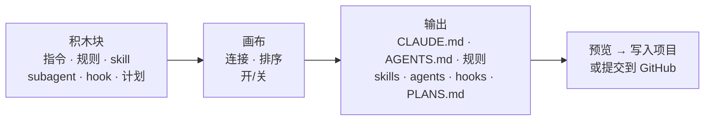

<div align="center">

# Encela

**AI 编程工具的桌面助手：用积木块可视化地搭建 Claude Code 和 Codex 配置、管理 git 工作、为每个分支记笔记——就在你的终端旁边。**

[English](README.md) · [한국어](READMEkr.md) · **中文**

[](https://github.com/oceanstarlight/ai-management-pg-fo-desktop/releases/latest)

[](LICENSE)

</div>

> [!NOTE]
> 项目处于早期开发阶段。目前优先支持 Windows，Linux 和 macOS 计划在之后支持。
>
> 应用界面目前提供英文和韩文。

<!-- 截图：主窗口（文档编排器）— 例如 docs/images/composer.png -->

## 为什么做这个

AI 编程工具通过一大堆文件来配置：`CLAUDE.md`、`AGENTS.md`、规则、skill、subagent、hook、MCP 服务器，还有分三个作用域的设置文件。很难看清哪些真正生效了，手写也很费时。

Encela 把这些都放进一个窗口：

- **看清**：项目里 AI 工具读取了什么、从哪里读取。
- **搭建**：把积木块拼在一起生成指令文件，不必从零手写。
- **工作**：在应用里完成 git 和 GitHub 操作，并为每个分支维护待办列表。
- **停靠**：一个窄边栏贴在终端或编辑器旁边，随时可见。

## 功能一览

| 页面 | 可以做什么 |
|---|---|
| 🧩 **文档编排器** | 把积木块拖到画布上，生成 `CLAUDE.md` / `AGENTS.md`、规则、skill、subagent、hook 和 `PLANS.md` |
| 🗺️ **设置地图** | 显示工具加载的所有指令、规则、skill、subagent、命令、MCP 服务器和设置，以及作用域和状态 |
| 📄 **项目文档** | 打开文件夹即可在应用内编辑 AI 配置文件，磁盘上的文件变化时会提醒你 |
| 📚 **资源库** | 收藏常用的 skill 和 subagent，按项目启用或停用；一键安装 GitHub 上热门的开源扩展（插件、MCP 服务器） |
| ⏰ **自动化** | 让你的 `claude` 按计划工作（例如每天早上用 Haiku 子代理收集新闻并发邮件给你）；可在文档编辑器中搭建，或让 Claude Code 创建 |
| 🔌 **MCP 服务器** | 查看、添加、编辑、删除 MCP 服务器并检查连接；粘贴 JSON 片段或 `claude mcp add` 命令即可导入 |
| 🌿 **工作** | 分支、worktree、diff、提交 / 推送 / 拉取、PR、CI 状态、合并冲突助手 |
| 📝 **笔记** | 按仓库和分支记笔记和待办，可在多台设备间同步 |
| 📌 **边栏** | 停靠在你正在使用的窗口旁并跟随它移动的窄面板 |

## 支持的工具

每个项目使用一个工具。应用会根据项目中的文件自动识别（也可以手动切换），所有页面都按该工具工作。

| | Claude Code | Codex |
|---|:---:|:---:|
| 设置地图、资源库、项目文档 | ✅ | ✅ |
| 文档编排器 | ✅ | ✅（指令写入 `AGENTS.md`；Codex 没有规则文件夹） |
| MCP 服务器 | ✅（含连接检查） | ✅（无连接检查） |
| worktree、AI 生成提交信息草稿 | ✅ | ✅ |
| 工具内的分支笔记 mod | ✅ | — |

## 安装

1. 从 **[Releases](https://github.com/oceanstarlight/ai-management-pg-fo-desktop/releases/latest)** 下载最新的 `*-setup.exe`。
2. 运行安装程序。安装包暂未进行代码签名，Windows SmartScreen 可能会提示警告：点击 **更多信息 → 仍要运行**。
3. 应用会在启动时和每 6 小时检查一次更新，并提供 **更新并重启**。

**还需要**

- 如需使用 AI 相关功能，请安装 [Claude Code](https://docs.claude.com/en/docs/claude-code) 和/或 [Codex](https://github.com/openai/codex)。应用只运行你已安装的 `claude` / `codex` 命令，不会索取你的登录信息。
- 使用"工作"页面需要安装 [Git](https://git-scm.com/)。

## 快速开始

1. **选择项目**：打开 **设置地图** 并选择一个项目文件夹，即可按作用域看到工具当前在该项目中加载的内容。
2. **打开文档编排器**：把几个积木块拖到画布上，连接到 `CLAUDE.md` 等输出，并在右侧查看预览。
3. **写入项目**：写入前会预览每个文件的全部改动。
4. **切换到边栏**：开始写代码时切换。按 <kbd>Ctrl</kbd>+<kbd>Alt</kbd>+<kbd>Space</kbd> 显示或隐藏边栏，或通过托盘图标回到主窗口。

## 详细介绍

### 🧩 文档编排器

<!-- 截图：画布与"预期效果"面板 — 例如 docs/images/composer-ratings.png -->

像节点图一样搭建 AI 指令文件。



- **约 100 个现成积木块**：既有应用自带的，也有来自热门开源合集并经过许可证核查的（obra/superpowers、mattpocock/skills、anthropics/skills、wshobson/agents、VoltAgent subagents、awesome-cursorrules 等）。每个积木块都记录了来源、提交和许可证，详见 [`THIRD_PARTY_NOTICES.md`](THIRD_PARTY_NOTICES.md)。
- **预期效果**：每个积木块用箭头标出它会提高还是降低 **token**、**性能** 和 **质量**（−2 到 +2）。画布会把已放置的积木块相加，用条形图显示性能、质量和 token 消耗。
- **点击积木块** 可查看它会让 AI 做什么以及完整内容。双击积木块或输出可预览真实文件。
- **subagent** 可选择模型（自动、Fable、Opus、Sonnet、Haiku）。**hook** 设置事件和命令，确认后合并进设置文件。
- **计划**：用主要目标、子目标和步骤（写说明、交给 subagent、使用 skill、向用户提问）生成 `PLANS.md`，并标记为已完成 / 进行中 / 未开始。
- **安全写入**：在 `CLAUDE.md` 中只管理应用自己标记的区块，不会在未询问的情况下覆盖非应用写入的文件。
- **无需克隆即可写入**：可把结果直接提交到 GitHub 仓库的某个分支，或创建新的 PR。
- 还支持撤销 / 重做、团队与个人输出（`CLAUDE.md` / `CLAUDE.local.md`），以及从源仓库刷新第三方积木块的"获取最新"。

### 🗺️ 设置地图

显示所选项目中工具读取的一切：指令、规则、skill、subagent、命令、MCP 服务器和设置，按 **作用域**（个人 / 项目 / 本地）分组，并标出 **状态**（使用中、有条件、已关闭、被覆盖、JSON 错误等）。

### 📄 项目文档 · 📚 资源库

- **项目文档** 会找出文件夹中的 `CLAUDE.md`（包括子文件夹）、`AGENTS.md`、规则、skill、agent、命令和设置文件，并允许在应用内编辑。
- **资源库** 存放你常用的 skill 和 subagent，一键添加到项目或从项目移除。
- **GitHub 扩展**：经过许可证检查的开源 Claude Code 扩展（REA、superpowers、compound-engineering、agent-skills、wshobson/agents、VoltAgent subagents），用你自己的 `claude` 命令安装。

### ⏰ 自动化

- 设定时间（每天、指定星期）或间隔、模型、允许使用的工具，以及接收结果的邮箱。
- 在文档编辑器中把指令、规则、skill 和子代理块连接到 **自动化** 输出，它们会成为运行时的指令和子代理（例如用 Haiku 运行的抓取子代理）。
- 在应用或托盘图标运行期间，用你自己的 `claude -p` 执行；应用关闭期间错过的运行，如在一天之内，会补跑一次。每次运行都会保存结果、费用和错误，并发送桌面通知。
- 结果通过连接到 Claude Code 的邮件 MCP 服务器（如 Gmail）发送。Claude Code 也可以通过应用的 MCP 服务器查看、创建和运行自动化。

### 🔌 MCP 服务器

在一个页面管理项目（`.mcp.json`）、本地和个人服务器：检查能否连接，添加 / 编辑 / 删除，开关项目服务器，或安装推荐服务器。密钥会被遮盖显示，并建议使用 `${变量}` 引用而不是把密钥直接写进文件。Claude Code 的个人服务器通过你自己的 `claude mcp` 命令管理。

### 🌿 工作（git · GitHub）

<!-- 截图：带流程卡片的工作页面 — 例如 docs/images/work.png -->

- **流程卡片** 显示分支进展到哪一步：提交 → 推送 → PR → CI，并提供下一步按钮。
- 按文件暂存改动、带 diff 的历史、分支和 worktree。
- 用你自己的 `claude` 或 `codex` 命令生成 **提交信息草稿**。
- **登录 GitHub** 后可查看 PR、CI 和 issue，创建 PR，并在 CI 结束或 PR 被合并 / 关闭时收到桌面通知。
- **从你的 GitHub 仓库中选择**：有本地克隆就直接打开；没有的话可以直接在 GitHub 上浏览分支、提交和 PR，编辑文件并提交，或克隆到本地。
- **冲突助手** 引导你逐个处理冲突块（当前 / 传入 / 两者都要）。

### 📝 笔记与同步

- 按仓库和分支记录笔记和待办。在终端切换分支时，笔记也会跟着切换。
- 可选：用应用账号（邮箱、Google 或 GitHub）在多台设备间同步笔记、编排器文档和资源库。两台设备同时修改同一内容时，保留较新的版本，另一份作为副本保存。目前同步仅对已获批准的账号开放。

### 🔗 在 Claude Code 内：分支笔记 mod

在设置中安装 **分支笔记 mod**（需要 Claude Code 2.1.287 或更高版本）后，Claude Code 会在输入框上方用一行显示当前分支的待办、PR 和 CI，新增 `/todo`、`/memo` 和 `/notes` 命令，并让 Claude 在工作时读取你的笔记。输入提示词时，它会在输入框上方推荐合适的 skill、子代理和命令（已有的）、资源库条目（点一下即可加入项目）以及可安装的扩展。默认在你停止输入后通过你自己的 Claude Code 让 Haiku 挑选；也可以在设置中改为关键词匹配或关闭。也可以在设置中安装推荐的社区 mod（token-weather、blast-radius、replay-theater、claude-hud）。

### 📌 边栏

停靠在你正在使用的窗口（Windows Terminal、VS Code、Claude 桌面版、Codex）旁并跟随它。设置项：磁吸开关、始终置顶、显示 / 隐藏快捷键、主题、语言（英文 / 韩文）、字号。

## 隐私与安全

- 应用 **绝不读取、复制或保存你的 Claude 登录信息**（`~/.claude/.credentials.json` 或令牌）。AI 功能只是原样运行你安装的 `claude` / `codex` 命令。
- GitHub 和账号令牌保存在系统凭据存储（Windows 凭据管理器）中。GitHub 令牌只会以环境变量形式传给单条 git 命令。
- 设置文件按"读取 → 合并 → 写入"的方式修改，应用不认识的键会原样保留。
- 在你登录并开启同步之前，不会向服务器发送任何内容。

## 开发者

<details>
<summary><b>从源码构建</b></summary>

**环境要求**

- Node.js 22+ 和 pnpm 10（`corepack enable`）
- Rust 1.90+（`rustup`）
- Windows：[Microsoft C++ Build Tools](https://visualstudio.microsoft.com/visual-cpp-build-tools/)（"使用 C++ 的桌面开发"）和 WebView2（Windows 11 已内置）
- Linux：`libwebkit2gtk-4.1-dev libxdo-dev libayatana-appindicator3-dev librsvg2-dev`

另见 [Tauri prerequisites](https://v2.tauri.app/start/prerequisites/)。

```bash
pnpm install
pnpm tauri dev      # 以开发模式运行应用
pnpm lint           # Biome 代码检查 + 格式检查
pnpm build          # 类型检查 + 前端构建
pnpm tauri build    # 构建安装包
```

Rust 检查（在 `src-tauri/` 中）：

```bash
cargo fmt --check
cargo clippy --all-targets -- -D warnings
cargo test
```

Claude Code mod 检查（在 `claude-mod/branch-notes/` 中）：

```bash
claude plugin validate .
claude plugin test .
```

</details>

<details>
<summary><b>目录结构</b></summary>

| 路径 | 内容 |
|---|---|
| `src/` | React 19 + TypeScript 前端（`workspace/` 主窗口、`sidebar/` 边栏、`features/` 共用面板） |
| `src-tauri/` | Rust 后端（Tauri 2）。`tools/` 为每个 AI 工具提供适配器，`catalog/` 存放编排器积木块 |
| `claude-mod/` | Claude Code mod（通过 `<应用数据>/bridge` 中的文件与应用通信） |
| `firebase/` | 同步的安全规则 |
| `docs/` | 计划、调研资料、配置指南、测试清单（韩文） |

</details>

<details>
<summary><b>文档</b></summary>

- [`docs/PLAN.md`](docs/PLAN.md)：决策与路线图
- [`docs/research.md`](docs/research.md)：附来源的调研资料
- [`docs/sync-setup.md`](docs/sync-setup.md)：同步（Firebase）配置
- [`docs/release-setup.md`](docs/release-setup.md)：发布与应用更新
- [`docs/testing/`](docs/testing/)：手动测试清单

</details>

CI（`.github/workflows/ci.yml`）在 Linux 上进行代码检查和构建，并构建 Windows 安装包。合并到 `main` 的每个新版本都会发布为 GitHub Release。

## 许可证

[Apache-2.0](LICENSE)。打包的第三方积木块的许可证列在 [`THIRD_PARTY_NOTICES.md`](THIRD_PARTY_NOTICES.md) 中。

本项目与 Anthropic 或 OpenAI 无关，未获得其赞助或认可。Claude 是 Anthropic, PBC 的商标；Codex 和 ChatGPT 是 OpenAI 的商标。
